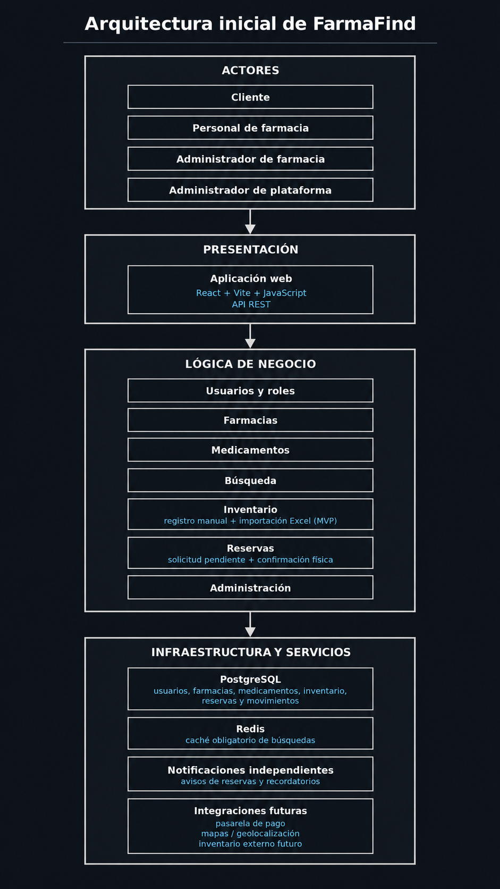

# Arquitectura inicial del sistema FarmaFind

> **Nota:** la imagen deberá actualizarse para reflejar Redis como caché obligatoria, PostgreSQL como base de datos principal y la separación entre el núcleo FarmaFind y el servicio de Notificaciones.

## Resumen de la arquitectura

| Elemento | Descripción |
|---|---|
| Actores | Representa a los usuarios principales del sistema: cliente, personal de farmacia, administrador de farmacia y administrador de plataforma. |
| Presentación | Corresponde a la aplicación web desarrollada con React, desde donde los usuarios interactúan con FarmaFind mediante una API REST. Las búsquedas públicas no requerirán autenticación. |
| Lógica de negocio | Contiene el núcleo FarmaFind, desarrollado con Node.js, Express y TypeScript, organizado como un monolito modular con Clean Architecture. Incluye Usuarios, Farmacias, Medicamentos, Búsqueda, Inventario, Reservas y Administración. Las operaciones críticas utilizarán Unit of Work para mantener la consistencia transaccional. |
| Datos | Utiliza PostgreSQL como base de datos principal para almacenar usuarios, farmacias, medicamentos, inventario, reservas y eventos Outbox. Garantiza la consistencia de las operaciones críticas mediante transacciones. |
| Caché | Utiliza Redis como componente obligatorio del MVP para almacenar temporalmente resultados de búsqueda de medicamentos y farmacias mediante Cache-Aside. Las entradas tendrán TTL e invalidación. Si Redis falla, las búsquedas continuarán consultando PostgreSQL. |
| Servicio separado | Incluye Notificaciones como servicio independiente del núcleo FarmaFind. Procesará avisos relacionados con las reservas mediante eventos registrados con Transactional Outbox y publicados por HTTPS/REST interno autenticado, aplicando reintentos y deduplicación. |
| Sistemas externos | Considera un proveedor de mapas para consultar ubicaciones y distancias, con alternativa de dirección textual ante fallos. Los pagos electrónicos y la sincronización automática con inventarios externos se mantienen como funcionalidades futuras. |
