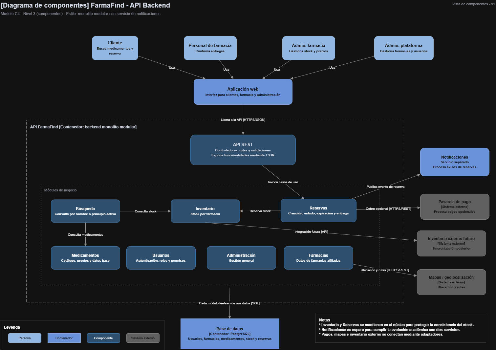

# Componentes arquitectónicos del sistema FarmaFind

> **Estado:** diseño propuesto, pendiente de implementación y validación.

## Resumen de componentes

| Componente | Descripción |
|---|---|
| Aplicación web | Interfaz propuesta con React + Vite + JavaScript/JSX, desde donde clientes, personal de farmacia y administradores interactúan con FarmaFind. Las búsquedas públicas no requerirán autenticación y mostrarán disponibilidad referencial y fecha de actualización; la existencia física quedará sujeta a aceptación de la farmacia. |
| API REST | Desarrollada con Node.js, Express y TypeScript. Expone las funciones del sistema mediante HTTPS/JSON y aplica autenticación, autorización y validación de solicitudes. |
| Módulos de negocio | Agrupan Usuarios, Farmacias, Medicamentos, Búsqueda, Inventario, Reservas y Administración dentro de un monolito modular con Clean Architecture y SOLID. Inventario incluirá registro manual e importación obligatoria .xlsx/.csv al catálogo general con vista previa, validación y mapeo; cada farmacia gestionará precios y stock sin sobrescribir compromisos, conciliando discrepancias. |
| Base de datos | PostgreSQL almacena usuarios, farmacias, medicamentos, inventario, movimientos_inventario, reservas y eventos Outbox. Las operaciones críticas de Reservas e Inventario utilizan transacciones para garantizar la consistencia. |
| Caché Redis | Componente obligatorio del MVP que almacena temporalmente resultados de búsquedas mediante Cache-Aside. Utiliza TTL e invalidación de datos. Si Redis falla, las búsquedas continúan consultando PostgreSQL. |
| Notificaciones | Servicio independiente del núcleo FarmaFind, encargado de procesar avisos de reservas, alertas de corrección y recordatorios propuestos de actualización, sin alterar existencias. Recibe eventos registrados mediante Transactional Outbox y publicados por HTTPS/REST interno autenticado, aplicando reintentos y deduplicación. |
| Sistemas externos | Incluyen un proveedor de mapas para consultas de ubicación, con dirección textual como alternativa. Los pagos electrónicos y la sincronización automática con inventarios externos se consideran funcionalidades futuras. |
