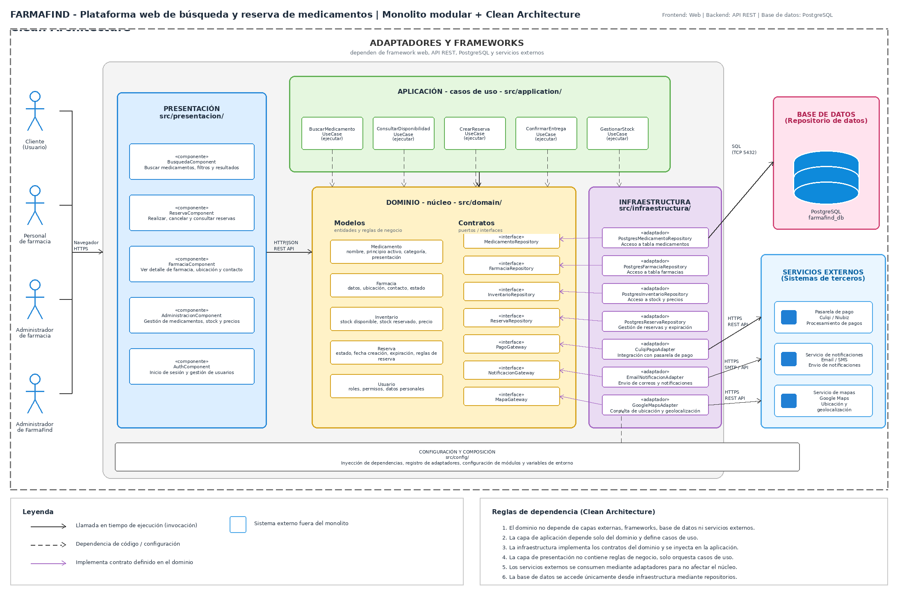

# Enfoque arquitectónico del sistema FarmaFind

> **Nota:** la imagen deberá actualizarse para representar correctamente las capas de Clean Architecture, Redis como caché obligatoria, PostgreSQL como base de datos principal y el servicio independiente de Notificaciones.

## Resumen del enfoque

| Capa | Descripción |
|---|---|
| Presentación | Contiene la aplicación web desarrollada con React y los controladores de la API REST. Permite que clientes, personal de farmacia y administradores interactúen con FarmaFind. Las búsquedas públicas no requieren autenticación. |
| Aplicación | Agrupa los casos de uso principales: buscar medicamentos, consultar disponibilidad, crear y cancelar reservas, confirmar reservas y entregas, y gestionar inventario. Coordina las operaciones mediante contratos, incluyendo Cache-Aside para búsquedas y Unit of Work para transacciones de reservas. |
| Dominio | Contiene las entidades, reglas de negocio y contratos del sistema. Define los estados de reserva PENDIENTE, CONFIRMADA, ENTREGADA, CANCELADA y EXPIRADA, así como las reglas de disponibilidad y stock. No depende directamente de tecnologías externas. |
| Infraestructura | Implementa los repositorios y adaptadores que conectan los casos de uso con PostgreSQL, Redis y servicios externos. Incluye el adaptador de caché Redis y los mecanismos de registro y publicación de eventos mediante Transactional Outbox. |
| Base de datos | PostgreSQL almacena usuarios, farmacias, medicamentos, inventario, reservas y eventos Outbox. Es la fuente oficial de información y permite garantizar la consistencia mediante transacciones. |
| Caché | Redis es obligatorio en el MVP para almacenar temporalmente resultados de búsqueda mediante Cache-Aside. Utiliza TTL e invalidación de datos relevantes. Si Redis falla, las búsquedas continúan consultando PostgreSQL. |
| Servicio independiente | Notificaciones funciona como un servicio separado del núcleo FarmaFind. Recibe eventos registrados mediante Transactional Outbox, procesa avisos relacionados con reservas y aplica reintentos y deduplicación. |
| Servicios externos | Incluyen el proveedor de mapas para consultar ubicaciones, con dirección textual como alternativa ante fallos. Los pagos electrónicos y la sincronización automática con inventarios externos quedan previstos para futuras iteraciones. |

