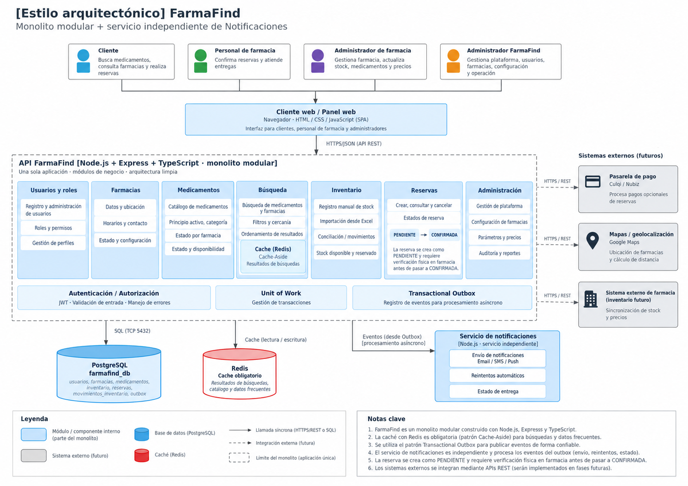

# Estilo arquitectónico del sistema FarmaFind

> **Nota:** la imagen deberá actualizarse para representar el monolito modular, Clean Architecture, PostgreSQL, Redis y Notificaciones independiente, además de importación de Excel, conciliación de inventario y aceptación tras comprobación física.

> **Estado:** diseño propuesto, pendiente de implementación y validación.

## Resumen del estilo arquitectónico

| Elemento | Descripción |
|---|---|
| Estilo principal | FarmaFind utilizará una arquitectura cliente-servidor con un backend de tipo monolito modular, organizado internamente mediante Clean Architecture. |
| Cliente-servidor | Los usuarios accederán mediante una aplicación web desarrollada con React, Vite y JavaScript (JSX), que se comunicará con la API REST mediante HTTPS y JSON. |
| Monolito modular | El backend se desarrollará con Node.js, Express y TypeScript. Se organizará en módulos de Usuarios, Farmacias, Medicamentos, Búsqueda, Inventario, Reservas y Administración, manteniendo responsabilidades y contratos definidos. Inventario incluirá registro manual e importación obligatoria .xlsx/.csv con vista previa, validación y mapeo al catálogo general, sin sincronización automática externa. El módulo Pagos quedará previsto para una futura iteración. |
| Capas | Cada módulo seguirá Clean Architecture, separando Presentación, Aplicación, Dominio e Infraestructura. Las reglas de negocio no dependerán directamente de Express, PostgreSQL, Redis ni proveedores externos. |
| Base de datos | PostgreSQL será la base de datos principal y la fuente oficial de información. Las operaciones de Reservas e Inventario utilizarán transacciones compartidas mediante Unit of Work para garantizar la consistencia del stock digital. Los ajustes e importaciones no sobrescribirán compromisos y requerirán conciliación ante discrepancias, conservando movimientos_inventario. La existencia física se comprobará al aceptar la reserva. |
| Caché Redis | Redis será obligatorio en el MVP para optimizar las búsquedas de medicamentos y farmacias mediante Cache-Aside. Utilizará TTL e invalidación de resultados. Si Redis falla, las búsquedas continuarán consultando PostgreSQL. |
| Servicio independiente | Notificaciones será un servicio separado del núcleo FarmaFind, desarrollado con Node.js y TypeScript. Recibirá eventos registrados mediante Transactional Outbox y publicados por HTTPS/REST interno autenticado, aplicando reintentos y deduplicación. |
| Servicios externos | El sistema podrá utilizar un proveedor de mapas para consultar ubicaciones, con dirección textual como alternativa ante fallos. Los pagos electrónicos y la integración automática con inventarios externos quedarán para futuras iteraciones y se conectarán mediante adaptadores. |
