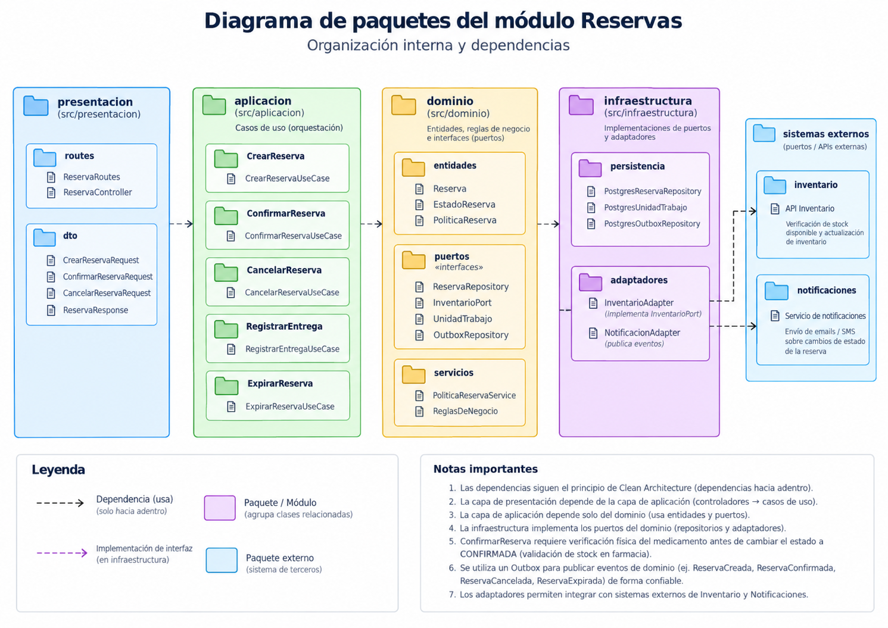
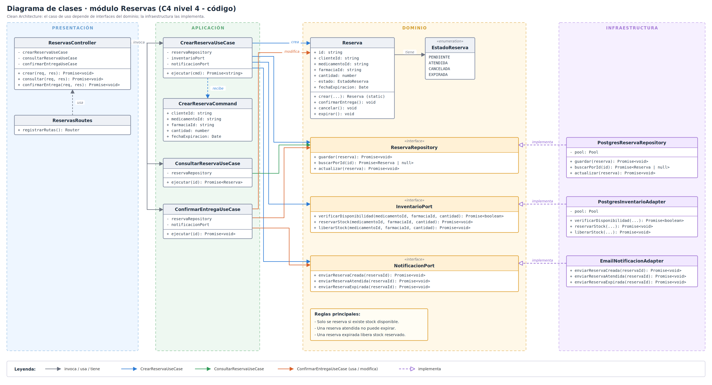
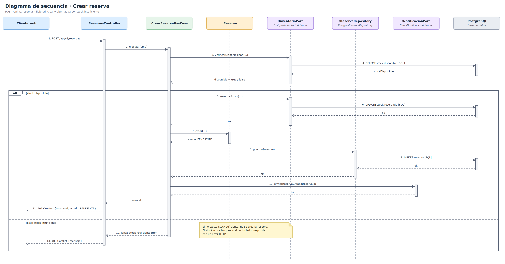

# Diseño interno de módulos

> **Proyecto:** FarmaFind  
> **Backend propuesto:** Node.js + Express + TypeScript  
> **Módulo de referencia:** Reservas  
> **Estilo arquitectónico:** Monolito modular organizado por capas  
> **Enfoque arquitectónico:** Clean Architecture dentro de cada módulo  
> **Nivel C4:** 4 - Código  
> **Versión:** 1.1  
> **Estado:** Diseño propuesto, pendiente de implementación

---

## 1. Propósito

Este documento describe cómo se organizará el código dentro de un módulo del backend de FarmaFind. Se toma como referencia el módulo **Reservas**, porque representa uno de los procesos más importantes del sistema: solicitar temporalmente un medicamento con disponibilidad digital, sujeto a comprobación física para que el cliente pueda recogerlo en una farmacia.

El objetivo de este diseño interno es:

- mantener una estructura común para todos los módulos;
- separar las reglas de negocio de los detalles técnicos;
- facilitar el mantenimiento del sistema;
- permitir que cada integrante del equipo sepa dónde ubicar cada archivo;
- evitar dependencias directas entre el dominio y tecnologías como Express, PostgreSQL o servicios externos;
- garantizar que las reservas y las operaciones sobre inventario mantengan consistencia transaccional;
- permitir que las notificaciones sean procesadas sin afectar la confirmación de una reserva;
- mantener coherencia con el modelo C4 Nivel 4 y las decisiones arquitectónicas del proyecto.

La arquitectura propuesta corresponde a un **monolito modular**, donde los módulos principales se ejecutarán dentro de una misma aplicación backend, manteniendo responsabilidades y contratos definidos.

El servicio de **Notificaciones** se ejecutará como un proceso separado, conforme a las restricciones académicas del proyecto.

El pago electrónico será considerado una funcionalidad opcional para una futura iteración. El flujo principal del MVP no dependerá de una pasarela de pago.

---

## 2. Estructura de carpetas

La siguiente estructura representa la organización propuesta del módulo Reservas y no implica que los archivos ya estén implementados.

```text
src/
└── modules/
    └── reservas/
        ├── dominio/
        │   ├── reserva.ts
        │   ├── estado-reserva.ts
        │   ├── reserva-repository.ts
        │   ├── inventario-port.ts
        │   └── notificacion-port.ts
        ├── aplicacion/
        │   ├── crear-reserva.use-case.ts
        │   ├── consultar-reserva.use-case.ts
        │   ├── aceptar-reserva.use-case.ts
        │   ├── confirmar-entrega.use-case.ts
        │   ├── cancelar-reserva.use-case.ts
        │   ├── expirar-reserva.use-case.ts
        │   └── crear-reserva.command.ts
        ├── infraestructura/
        │   ├── postgres-reserva.repository.ts
        │   ├── postgres-inventario.adapter.ts
        │   ├── postgres-outbox.adapter.ts
        │   └── notificacion-evento.adapter.ts
        ├── presentacion/
        │   ├── reservas.controller.ts
        │   └── reservas.routes.ts
        ├── reservas.module.ts
        └── index.ts

src/
└── shared/
    └── transacciones/
        ├── transaccion-contexto.ts
        └── unidad-trabajo.ts
```

La carpeta `shared/transacciones/` representa contratos técnicos compartidos que permiten coordinar operaciones de varios módulos dentro de una misma transacción.

| Archivo | Capa | Responsabilidad | Importa de |
|---|---|---|---|
| `reserva.ts` | Dominio | Representa una reserva, sus validaciones y transiciones de estado. | `estado-reserva.ts` |
| `estado-reserva.ts` | Dominio | Define los cinco estados del ciclo de vida de una reserva. | Nada |
| `reserva-repository.ts` | Dominio | Declara las operaciones necesarias para guardar, consultar y actualizar reservas. | `reserva.ts` |
| `inventario-port.ts` | Dominio | Declara operaciones para comprometer, liberar y confirmar el consumo de stock. | Contratos de transacción |
| `notificacion-port.ts` | Dominio | Declara el contrato para registrar eventos de notificación relacionados con reservas. | Contratos de transacción |
| `crear-reserva.use-case.ts` | Aplicación | Coordina la creación transaccional de una reserva. | Dominio y abstracciones compartidas |
| `consultar-reserva.use-case.ts` | Aplicación | Consulta el estado de una reserva y verifica permisos de acceso. | Dominio |
| `aceptar-reserva.use-case.ts` | Aplicación | Verificará dueño, administrador o delegación expresa y comprobación física; coordinará aceptación o cancelación por falta física. | Dominio y puertos necesarios |
| `confirmar-entrega.use-case.ts` | Aplicación | Confirma la entrega de una reserva vigente y autorizada. | Dominio y puertos necesarios |
| `cancelar-reserva.use-case.ts` | Aplicación | Gestiona la cancelación y liberación del stock comprometido. | Dominio y puertos necesarios |
| `expirar-reserva.use-case.ts` | Aplicación | Gestiona el vencimiento de reservas y la liberación segura del stock. | Dominio y puertos necesarios |
| `crear-reserva.command.ts` | Aplicación | Define los datos de entrada del caso de uso de creación de reserva. | Nada |
| `postgres-reserva.repository.ts` | Infraestructura | Implementa la persistencia de reservas en PostgreSQL. | Dominio y driver de base de datos |
| `postgres-inventario.adapter.ts` | Infraestructura | Implementa operaciones transaccionales de inventario. | Contratos internos y PostgreSQL |
| `postgres-outbox.adapter.ts` | Infraestructura | Registra eventos pendientes dentro de PostgreSQL. | Contrato de notificaciones y PostgreSQL |
| `notificacion-evento.adapter.ts` | Infraestructura | Permite conectar la publicación de eventos con el servicio separado de Notificaciones. | Contratos y mecanismos externos |
| `reservas.controller.ts` | Presentación | Recibe solicitudes HTTP y devuelve respuestas JSON. | Aplicación |
| `reservas.routes.ts` | Presentación | Define las rutas REST del módulo Reservas. | Presentación |
| `reservas.module.ts` | Composición | Configura las dependencias concretas del módulo. | Todas las capas |
| `index.ts` | Composición | Expone la API pública del módulo. | `reservas.module.ts` |
| `transaccion-contexto.ts` | Abstracción compartida | Representa el contexto de una transacción. | Nada externo |
| `unidad-trabajo.ts` | Abstracción compartida | Define cómo ejecutar operaciones coordinadas dentro de una transacción. | `transaccion-contexto.ts` |

### Organización de responsabilidades

Aunque Reservas necesite operaciones de Inventario, no deberá modificar directamente las tablas de ese módulo.

Las operaciones se realizarán mediante contratos definidos, manteniendo la separación lógica de responsabilidades.

La implementación de infraestructura garantizará que la operación de inventario y el registro de la reserva compartan una misma transacción PostgreSQL.

---

## 3. Capas del módulo y regla de dependencia

El módulo se organizará siguiendo Clean Architecture.

La regla principal establece que las dependencias del código deben apuntar hacia las abstracciones internas y no hacia implementaciones tecnológicas concretas.



```text
Presentación → Aplicación → Dominio
Infraestructura → Dominio / Contratos de aplicación
Composición → Todas las capas
```

| Capa | Contiene | Responsabilidad | Puede depender de | No puede depender de |
|---|---|---|---|---|
| Dominio | Entidades, estados y contratos | Define las reglas principales de las reservas. | Modelos y abstracciones internas. | Express, PostgreSQL, controladores o adaptadores concretos. |
| Aplicación | Casos de uso y comandos | Coordina los procesos de negocio, transacciones y contratos necesarios. | Dominio y abstracciones compartidas. | Infraestructura concreta, Express o driver PostgreSQL. |
| Infraestructura | Repositorios y adaptadores | Implementa contratos utilizando tecnologías concretas. | Dominio, contratos de aplicación y librerías externas. | Reglas de presentación. |
| Presentación | Controladores y rutas | Traduce solicitudes HTTP hacia casos de uso. | Aplicación. | Base de datos directamente. |
| Composición | `reservas.module.ts` | Une casos de uso, repositorios, adaptadores y transacciones. | Todas las capas. | No aplica. |

### Regla de dependencia

El dominio no debe importar librerías de base de datos, frameworks web ni mecanismos de comunicación externa.

Los casos de uso recibirán los contratos necesarios mediante inyección de dependencias.

La infraestructura implementará dichos contratos sin obligar a modificar el dominio.

### Regla de consistencia entre módulos

La creación de una reserva requiere coordinar Reservas e Inventario mediante una misma unidad de trabajo.

Las operaciones que deberán confirmarse conjuntamente son:

1. Comprometer de forma atómica la cantidad de stock solicitada.
2. Crear y guardar la reserva con estado PENDIENTE.
3. Registrar el evento de reserva creada en el mecanismo Outbox.
4. Confirmar la transacción únicamente si todas las operaciones anteriores fueron exitosas.

Si alguna operación falla, la transacción deberá revertirse.

### Regla de comunicación con Notificaciones

El caso de uso no enviará directamente un correo, SMS o mensaje externo antes de finalizar la transacción.

En su lugar, registrará un evento pendiente que será publicado y procesado posteriormente.

Así, una falla del servicio de Notificaciones no impedirá que una reserva correctamente registrada permanezca válida.

> **Criterio de revisión:** si una clase de dominio importa Express, PostgreSQL o servicios externos, se incumple la regla de dependencia. Si el flujo guarda inventario y reserva sin una transacción compartida, se incumple la regla de consistencia arquitectónica.

---

## 4. Diagrama de clases



El diagrama de clases deberá representar la organización propuesta para el módulo Reservas y sus principales relaciones con Inventario.

Las clases e interfaces del diseño se distribuyen entre dominio, aplicación, presentación e infraestructura.

### 4.1 Notación UML utilizada

| Símbolo | Significado | Ejemplo en el módulo Reservas |
|---|---|---|
| Línea continua con flecha abierta | Asociación entre clases o componentes. | `CrearReservaUseCase` utiliza `ReservaRepository`. |
| Línea discontinua con flecha abierta | Dependencia o uso puntual. | `ReservasController` crea un `CrearReservaCommand`. |
| Línea discontinua con triángulo hueco | Realización de una interfaz. | `PostgresReservaRepository` implementa `ReservaRepository`. |
| Rombo relleno | Composición. | Una entidad contiene objetos propios de su ciclo de vida. |
| `«interface»` | Contrato sin implementación concreta. | `ReservaRepository`, `InventarioPort`, `NotificacionPort`. |
| `+` / `-` | Público / privado. | `+ crear()`, `- estado`. |

### 4.2 Estados de la entidad Reserva

El ciclo de vida de una reserva utilizará los siguientes estados:

| Estado | Descripción |
|---|---|
| `PENDIENTE` | La reserva fue registrada y tiene stock comprometido; espera validación de la farmacia. |
| `CONFIRMADA` | La farmacia aceptó la reserva y el medicamento está pendiente de recojo. |
| `ENTREGADA` | El medicamento fue entregado al cliente y la operación finalizó correctamente. |
| `CANCELADA` | La reserva fue cancelada antes de su entrega. |
| `EXPIRADA` | La reserva superó su fecha límite sin entregarse. |

Los estados `ENTREGADA`, `CANCELADA` y `EXPIRADA` serán terminales.

### 4.3 Transiciones de estado

| Estado inicial | Estado final | Condición |
|---|---|---|
| PENDIENTE | CONFIRMADA | El dueño, administrador o personal expresamente delegado comprueba físicamente el producto y acepta la reserva vigente. |
| PENDIENTE | CANCELADA | Se realiza una cancelación autorizada. |
| PENDIENTE | EXPIRADA | Se agota el plazo de respuesta sin aceptación. |
| CONFIRMADA | ENTREGADA | Se confirma la entrega de una reserva vigente. |
| CONFIRMADA | CANCELADA | Se realiza una cancelación autorizada antes de la entrega. |
| CONFIRMADA | EXPIRADA | Se alcanza la fecha límite sin entrega. |

No se permitirá regresar desde un estado terminal hacia uno anterior.

PENDIENTE tendrá un plazo de respuesta configurable de 20 minutos iniciales desde su creación. Al aceptar, se sustituirá ese vencimiento por el plazo de recogida de CONFIRMADA desde la aceptación: 24 horas como valor inicial propuesto configurable, sujeto a validación.

Si falta existencia física, se cancelará PENDIENTE con motivo STOCK_FISICO_INSUFICIENTE. Unit of Work coordinará estado, liberación única del compromiso, incidencia, movimiento y alerta Outbox en una transacción; después del commit se invalidará caché. La corrección del stock físico requerirá conciliación, sin reducirlo por debajo de otros compromisos vigentes.

La transición hacia CANCELADA o EXPIRADA deberá coordinarse con la liberación del stock comprometido.

La transición hacia ENTREGADA deberá convertir la cantidad comprometida en una salida definitiva del inventario.

### 4.4 Consistencia del diagrama

El diagrama de clases deberá reflejar:

- `EstadoReserva` como enumeración única.
- `Reserva` como entidad responsable de validar transiciones.
- `CrearReservaUseCase` como coordinador de creación.
- `InventarioPort` como contrato para operaciones de stock.
- `ReservaRepository` como contrato de persistencia.
- `UnidadTrabajo` como abstracción para la transacción compartida.
- `NotificacionPort` como contrato de registro de eventos.
- Los adaptadores PostgreSQL en infraestructura.

---

## 5. Flujo de ejecución: crear reserva



El flujo principal representa una reserva temporal sin pago electrónico obligatorio.

La verificación y compromiso de stock, la creación de la reserva y el registro del evento de notificación se realizarán dentro de una única transacción PostgreSQL.

| Paso | Origen → destino | Acción | Capa |
|---|---|---|---|
| 1 | Cliente web → `ReservasController` | Envía una solicitud para reservar un medicamento. | Presentación |
| 2 | `ReservasController` → `CrearReservaUseCase` | Ejecuta el caso de uso utilizando los datos validados y la identidad autenticada. | Presentación → Aplicación |
| 3 | `CrearReservaUseCase` → `UnidadTrabajo` | Solicita iniciar una transacción PostgreSQL. | Aplicación → Contrato |
| 4 | `CrearReservaUseCase` → `InventarioPort` | Solicita comprometer stock de forma atómica. | Aplicación → Contrato |
| 5 | `PostgresInventarioAdapter` → PostgreSQL | Comprueba y actualiza el stock dentro de la transacción. | Infraestructura |
| 6 | `CrearReservaUseCase` → `Reserva` | Crea la entidad con estado PENDIENTE y fecha de expiración. | Aplicación → Dominio |
| 7 | `CrearReservaUseCase` → `ReservaRepository` | Solicita guardar la reserva dentro de la transacción. | Aplicación → Contrato |
| 8 | `PostgresReservaRepository` → PostgreSQL | Inserta la reserva utilizando el mismo contexto transaccional. | Infraestructura |
| 9 | `CrearReservaUseCase` → `NotificacionPort` | Solicita registrar el evento de reserva creada. | Aplicación → Contrato |
| 10 | `PostgresOutboxAdapter` → PostgreSQL | Guarda el evento pendiente dentro de la transacción. | Infraestructura |
| 11 | `UnidadTrabajo` → PostgreSQL | Confirma la transacción si todas las operaciones fueron exitosas. | Infraestructura |
| 12 | `ReservasController` → Cliente web | Responde con el identificador, estado y vencimiento de la reserva. | Presentación |
| 13 | Publicador Outbox → Servicio de Notificaciones | Publica posteriormente el evento pendiente. | Infraestructura → Servicio independiente |

### 5.1 Flujos alternativos

| Situación | Respuesta esperada |
|---|---|
| Stock insuficiente | No se crea la reserva y se devuelve `409 Conflict`. |
| Cantidad inválida | Se rechaza la solicitud con `400 Bad Request`. |
| Usuario no autenticado | Se rechaza la operación con `401 Unauthorized`. |
| Error durante la transacción | Se revierten los cambios de inventario, reserva y evento pendiente. |
| Falla de Notificaciones | La reserva permanece registrada y el evento queda pendiente de procesamiento. |
| Solicitudes concurrentes | No se permite comprometer más unidades que las disponibles. |

### 5.2 Flujo de cancelación y expiración

Cuando una reserva sea cancelada o expire, el sistema deberá:

1. Obtener la reserva dentro de una operación transaccional.
2. Verificar que se encuentra en un estado válido para la transición.
3. Cambiar el estado a CANCELADA o EXPIRADA.
4. Liberar una sola vez el stock comprometido.
5. Guardar el nuevo estado y el evento correspondiente.
6. Confirmar la transacción.

El proceso que detecte reservas expiradas deberá poder ejecutarse repetidamente sin liberar el mismo stock más de una vez.

### 5.3 Flujo de confirmación de entrega

Cuando el personal de farmacia confirme una entrega, el sistema deberá:

1. Validar la identidad y permisos del trabajador.
2. Verificar que pertenece a la farmacia correspondiente.
3. Consultar la reserva y comprobar su vigencia.
4. Verificar que la reserva se encuentra CONFIRMADA.
5. Cambiar el estado a ENTREGADA.
6. Registrar de forma transaccional la salida definitiva del inventario.
7. Guardar el evento correspondiente.
8. Confirmar la operación.

### 5.4 Consideración sobre pagos

Durante el MVP, el flujo principal finalizará con la creación de la reserva sin requerir pago electrónico.

El módulo Pagos podrá incorporarse posteriormente mediante contratos y adaptadores independientes, sin alterar las reglas esenciales de reserva e inventario.

---

## 6. Reglas internas del módulo Reservas

| Código | Regla |
|---|---|
| RN-01 | Una reserva solo puede crearse si existe stock disponible suficiente. |
| RN-02 | La cantidad solicitada debe ser un número entero positivo y no superar el stock disponible. |
| RN-03 | Toda reserva debe tener una fecha de expiración futura definida según la política del sistema. |
| RN-04 | Si una reserva expira, el stock comprometido debe liberarse una sola vez. |
| RN-05 | Solo el personal autorizado de la farmacia correspondiente puede confirmar la entrega. |
| RN-06 | Una reserva entregada, cancelada o expirada no puede regresar a un estado anterior. |
| RN-07 | El sistema debe evitar que las reservas concurrentes comprometan más unidades que el stock digital disponible registrado. |
| RN-08 | La creación de la reserva, el compromiso del stock y el registro del evento pendiente deben realizarse dentro de una única transacción. |
| RN-09 | El envío de notificaciones no debe impedir el funcionamiento de las reservas. |
| RN-10 | Las transiciones de estado deben respetar el ciclo de vida definido para la entidad Reserva. |
| RN-11 | La identidad del cliente debe provenir del contexto autenticado, no únicamente de los datos enviados por el navegador. |
| RN-12 | La creación de una reserva no requerirá pago electrónico durante el MVP. |

### Criterios adicionales de consistencia

- El stock comprometido no podrá superar el stock físico registrado; la existencia observada se comprobará antes de aceptar la reserva.
- La creación de una reserva no debe finalizar exitosamente si falla su persistencia.
- Una cancelación o expiración no puede devolver más unidades de las comprometidas.
- La entrega convierte las unidades comprometidas en una salida definitiva del inventario.
- Las operaciones críticas deben controlar cambios concurrentes de estado.
- Los errores de integración externa no deben dejar reservas parcialmente registradas.

---

## 7. Código de referencia

Los siguientes fragmentos TypeScript representan contratos y comportamientos de diseño.

**No constituyen una implementación ejecutable completa.** Su propósito es facilitar la comprensión de la arquitectura propuesta y orientar una implementación posterior.

### 7.1 Dominio · entidad e interfaces

#### Enumeración de estados

```ts
// dominio/estado-reserva.ts

export enum EstadoReserva {
  PENDIENTE = 'PENDIENTE',
  CONFIRMADA = 'CONFIRMADA',
  ENTREGADA = 'ENTREGADA',
  CANCELADA = 'CANCELADA',
  EXPIRADA = 'EXPIRADA',
}
```

#### Entidad Reserva

```ts
// dominio/reserva.ts

import { EstadoReserva } from './estado-reserva';

export class Reserva {
  private constructor(
    readonly id: string,
    readonly clienteId: string,
    readonly medicamentoId: string,
    readonly farmaciaId: string,
    readonly cantidad: number,
    private estado: EstadoReserva,
    public fechaExpiracion: Date,
  ) {}

  static crear(
    id: string,
    clienteId: string,
    medicamentoId: string,
    farmaciaId: string,
    cantidad: number,
    fechaExpiracion: Date,
  ): Reserva {

    if (!clienteId || !medicamentoId || !farmaciaId) {
      throw new Error('Los identificadores son obligatorios.');
    }

    if (!Number.isSafeInteger(cantidad) || cantidad <= 0) {
      throw new Error(
        'La cantidad debe ser un entero positivo.'
      );
    }

    if (
      Number.isNaN(fechaExpiracion.getTime()) ||
      fechaExpiracion.getTime() <= Date.now()
    ) {
      throw new Error(
        'La fecha de expiración debe ser futura.'
      );
    }

    return new Reserva(
      id,
      clienteId,
      medicamentoId,
      farmaciaId,
      cantidad,
      EstadoReserva.PENDIENTE,
      fechaExpiracion,
    );
  }

  obtenerEstado(): EstadoReserva {
    return this.estado;
  }

  estaVigente(ahora: Date): boolean {
    return ahora.getTime() < this.fechaExpiracion.getTime();
  }

  confirmar(ahora: Date, fechaLimiteRecogida: Date): void {
    if (this.estado !== EstadoReserva.PENDIENTE) {
      throw new Error(
        'Solo una reserva pendiente puede confirmarse.'
      );
    }

    if (!this.estaVigente(ahora)) {
      throw new Error('La reserva ya venció.');
    }

    if (
      Number.isNaN(fechaLimiteRecogida.getTime()) ||
      fechaLimiteRecogida.getTime() <= ahora.getTime()
    ) {
      throw new Error('El plazo de recogida debe ser futuro.');
    }

    this.fechaExpiracion = fechaLimiteRecogida;
    this.estado = EstadoReserva.CONFIRMADA;
  }

  confirmarEntrega(ahora: Date): void {
    if (this.estado !== EstadoReserva.CONFIRMADA) {
      throw new Error(
        'Solo una reserva confirmada puede entregarse.'
      );
    }

    if (!this.estaVigente(ahora)) {
      throw new Error('La reserva ya venció.');
    }

    this.estado = EstadoReserva.ENTREGADA;
  }

  cancelar(ahora: Date): void {
    if (
      this.estado !== EstadoReserva.PENDIENTE &&
      this.estado !== EstadoReserva.CONFIRMADA
    ) {
      throw new Error('La reserva no puede cancelarse.');
    }

    if (!this.estaVigente(ahora)) {
      throw new Error('La reserva debe procesarse como expirada.');
    }

    this.estado = EstadoReserva.CANCELADA;
  }

  expirar(ahora: Date): void {
    if (
      this.estado !== EstadoReserva.PENDIENTE &&
      this.estado !== EstadoReserva.CONFIRMADA
    ) {
      throw new Error('La reserva no puede expirar.');
    }

    if (this.estaVigente(ahora)) {
      throw new Error('La reserva todavía está vigente.');
    }

    this.estado = EstadoReserva.EXPIRADA;
  }
}
```

La entidad controla las transiciones de estado, pero no ejecuta consultas SQL ni envía notificaciones.

Las operaciones que afecten inventario deberán coordinarse desde los casos de uso y confirmarse mediante transacciones.

La autorización del trabajador o cliente deberá validarse en aplicación antes de modificar una reserva. Para aceptar, el caso de uso comprobará que actúa el dueño, administrador o personal expresamente delegado y registrará la comprobación física; calculará fechaLimiteRecogida según la configuración, sin recibirla libremente del navegador.

#### Contexto transaccional

```ts
// shared/transacciones/transaccion-contexto.ts

export interface TransaccionContexto {
  readonly id: string;
}
```

Este contrato es una abstracción ilustrativa. En infraestructura, el contexto deberá representar una transacción activa, por ejemplo, mediante un cliente PostgreSQL reservado para esa operación.

#### Unidad de trabajo

```ts
// shared/transacciones/unidad-trabajo.ts

import { TransaccionContexto } from './transaccion-contexto';

export interface UnidadTrabajo {
  ejecutar<T>(
    operacion: (tx: TransaccionContexto) => Promise<T>
  ): Promise<T>;
}
```

La implementación de `UnidadTrabajo` será responsable de iniciar, confirmar o revertir una transacción.

Los repositorios y adaptadores que participen en una misma operación deberán usar el mismo contexto transaccional.

#### Contrato de persistencia

```ts
// dominio/reserva-repository.ts

import { Reserva } from './reserva';
import { TransaccionContexto } from
  '../../../shared/transacciones/transaccion-contexto';

export interface ReservaRepository {

  guardar(
    reserva: Reserva,
    tx: TransaccionContexto
  ): Promise<void>;

  buscarPorId(
    id: string,
    tx?: TransaccionContexto
  ): Promise<Reserva | null>;

  actualizar(
    reserva: Reserva,
    tx: TransaccionContexto
  ): Promise<void>;
}
```

#### Contrato de Inventario

```ts
// dominio/inventario-port.ts

import { TransaccionContexto } from
  '../../../shared/transacciones/transaccion-contexto';

export interface InventarioPort {

  reservarStock(
    medicamentoId: string,
    farmaciaId: string,
    cantidad: number,
    tx: TransaccionContexto
  ): Promise<boolean>;

  liberarStock(
    medicamentoId: string,
    farmaciaId: string,
    cantidad: number,
    tx: TransaccionContexto
  ): Promise<void>;

  confirmarSalida(
    medicamentoId: string,
    farmaciaId: string,
    cantidad: number,
    tx: TransaccionContexto
  ): Promise<void>;
}
```

`reservarStock()` deberá verificar y comprometer stock mediante una operación atómica.

El valor `true` representa una reserva exitosa de unidades y `false` indica disponibilidad insuficiente.

`liberarStock()` permitirá recuperar unidades comprometidas cuando una reserva sea cancelada o expire.

`confirmarSalida()` convertirá las unidades comprometidas en una salida definitiva cuando se entregue el medicamento.

#### Contrato de Notificaciones

```ts
// dominio/notificacion-port.ts

import { TransaccionContexto } from
  '../../../shared/transacciones/transaccion-contexto';

export interface NotificacionPort {

  registrarReservaCreada(
    eventoId: string,
    reservaId: string,
    tx: TransaccionContexto
  ): Promise<void>;
}
```

Este contrato registra una solicitud de notificación dentro de la transacción.

El envío externo se realizará posteriormente mediante el mecanismo de publicación y el servicio independiente de Notificaciones.

---

### 7.2 Aplicación · caso de uso

#### Comando de creación

```ts
// aplicacion/crear-reserva.command.ts

export interface CrearReservaCommand {
  clienteId: string;
  medicamentoId: string;
  farmaciaId: string;
  cantidad: number;
}
```

El identificador del cliente deberá provenir de la identidad autenticada.

La fecha de expiración inicial se calculará con el plazo de respuesta PENDIENTE (20 minutos configurables). En el ejemplo, duracionReservaMs representará ese plazo, distinto del de recogida CONFIRMADA. El cliente no establecerá libremente los vencimientos.

#### Caso de uso CrearReserva

```ts
// aplicacion/crear-reserva.use-case.ts

import { Reserva } from '../dominio/reserva';
import { ReservaRepository } from
  '../dominio/reserva-repository';
import { InventarioPort } from '../dominio/inventario-port';
import { NotificacionPort } from
  '../dominio/notificacion-port';
import { CrearReservaCommand } from
  './crear-reserva.command';
import { UnidadTrabajo } from
  '../../../shared/transacciones/unidad-trabajo';

export class CrearReservaUseCase {

  constructor(
    private readonly reservaRepository: ReservaRepository,
    private readonly inventarioPort: InventarioPort,
    private readonly notificacionPort: NotificacionPort,
    private readonly unidadTrabajo: UnidadTrabajo,
    private readonly generarId: () => string,
    private readonly duracionReservaMs: number,
  ) {}

  async ejecutar(
    command: CrearReservaCommand
  ): Promise<string> {

    if (
      !Number.isSafeInteger(command.cantidad) ||
      command.cantidad <= 0
    ) {
      throw new Error('Cantidad inválida.');
    }

    if (
      !Number.isSafeInteger(this.duracionReservaMs) ||
      this.duracionReservaMs <= 0
    ) {
      throw new Error('Duración de reserva inválida.');
    }

    // La identidad autenticada, farmacia y medicamento
    // deberán validarse mediante los casos de uso y
    // mecanismos de autorización correspondientes.

    const reservaId = this.generarId();
    const eventoId = this.generarId();

    await this.unidadTrabajo.ejecutar(async (tx) => {

      const reservado = await this.inventarioPort.reservarStock(
        command.medicamentoId,
        command.farmaciaId,
        command.cantidad,
        tx
      );

      if (!reservado) {
        throw new Error(
          'No existe stock suficiente para la reserva.'
        );
      }

      const fechaExpiracion = new Date(
        Date.now() + this.duracionReservaMs
      );

      const reserva = Reserva.crear(
        reservaId,
        command.clienteId,
        command.medicamentoId,
        command.farmaciaId,
        command.cantidad,
        fechaExpiracion
      );

      await this.reservaRepository.guardar(reserva, tx);

      await this.notificacionPort.registrarReservaCreada(
        eventoId,
        reserva.id,
        tx
      );
    });

    return reservaId;
  }
}
```

#### Consideraciones del caso de uso

- `UnidadTrabajo` representa el límite de la transacción.
- Todas las operaciones reciben el mismo contexto `tx`.
- La actualización del inventario debe ser atómica.
- La reserva y el evento Outbox se registran en la misma transacción.
- Si una operación falla, se revierte la transacción completa.
- La generación de identificadores es independiente de la base de datos.
- Las notificaciones externas no se envían dentro de la transacción.
- El caso de uso no depende directamente de Express ni del driver PostgreSQL.

La validación de permisos, la comprobación de farmacia y medicamento, la política de duración y el tratamiento de reintentos deberán completarse durante la implementación.

---

### 7.3 Infraestructura · repositorio

La infraestructura implementará los contratos del dominio y de aplicación.

Para las operaciones críticas, Reservas e Inventario deberán compartir la misma conexión transaccional PostgreSQL.

La estructura propuesta incluye:

```text
infraestructura/
├── postgres-reserva.repository.ts
├── postgres-inventario.adapter.ts
├── postgres-outbox.adapter.ts
└── notificacion-evento.adapter.ts
```

#### Contrato de persistencia esperado

```ts
// infraestructura/postgres-reserva.repository.ts
// Esquema conceptual de las responsabilidades.

// guardar(reserva, tx):
//   INSERT INTO reservas (...)
//   utilizando la conexión de tx.

// buscarPorId(id, tx):
//   SELECT ...
//   reconstruir la entidad Reserva
//   con su estado persistido.

// actualizar(reserva, tx):
//   UPDATE reservas
//   SET estado = estado_actual_de_la_entidad
//   WHERE id = reserva.id;

// Las operaciones de cambio de estado deberán
// considerar bloqueos o controles de concurrencia.
```

Las consultas anteriores describen el contrato esperado. Su implementación definitiva dependerá del esquema relacional aprobado.

#### Reserva atómica de inventario

Se propone que el compromiso de stock se realice mediante una actualización condicional equivalente a:

```sql
UPDATE inventario
SET stock_reservado = stock_reservado + :cantidad
WHERE medicamento_id = :medicamentoId
  AND farmacia_id = :farmaciaId
  AND stock_total - stock_reservado >= :cantidad;
```

La operación será considerada exitosa únicamente si se actualiza exactamente una fila.

Se asume para este ejemplo que el inventario se identifica de forma única por farmacia y medicamento, que las columnas de stock son enteras y no negativas y que el esquema establece las restricciones correspondientes.

Si el modelo futuro incorpora sucursales, deberá utilizarse el identificador de sucursal en las operaciones de inventario y reservas.

La consulta deberá ejecutarse dentro de la misma transacción utilizada para registrar la reserva.

#### Registro Outbox

El adaptador Outbox deberá guardar información equivalente a:

| Campo | Descripción |
|---|---|
| `id` | Identificador único del evento |
| `tipo_evento` | Tipo de evento generado |
| `entidad_id` | Identificador de la reserva relacionada |
| `payload` | Información necesaria para procesar el evento |
| `estado` | Estado de publicación |
| `fecha_creacion` | Fecha de registro |
| `fecha_procesamiento` | Fecha de procesamiento, cuando corresponda |

El publicador procesará los eventos pendientes fuera de la transacción de creación de la reserva.

Los reintentos no deberán generar avisos duplicados para un mismo identificador lógico de evento.

#### Consideraciones transaccionales

La infraestructura deberá garantizar:

1. Una misma conexión transaccional para todas las operaciones relacionadas.
2. Confirmación de los cambios únicamente después de completar la operación.
3. Reversión ante errores.
4. Manejo de concurrencia para evitar reservas superiores al stock.
5. Reintentos controlados ante errores transitorios.
6. Registro de eventos pendientes sin depender de servicios externos.
7. Liberación segura y única del stock en cancelaciones y expiraciones.

---

### 7.4 Presentación · controlador y rutas

La capa de presentación recibirá las solicitudes HTTP y las convertirá en comandos de aplicación.

Las rutas protegidas requerirán autenticación y los casos de uso verificarán los permisos sobre los recursos correspondientes.

#### Controlador propuesto

```ts
// presentacion/reservas.controller.ts

import { Request, Response } from 'express';
import { CrearReservaUseCase } from
  '../aplicacion/crear-reserva.use-case';

export class ReservasController {

  constructor(
    private readonly crearReservaUseCase: CrearReservaUseCase
  ) {}

  async crear(
    req: Request,
    res: Response
  ): Promise<void> {

    // La identidad debe provenir de un middleware
    // de autenticación previamente ejecutado.
    // Se asume que este registra el usuario en res.locals.

    const clienteId = res.locals.usuario?.id;

    if (!clienteId) {
      res.status(401).json({
        error: 'No autenticado'
      });
      return;
    }

    const reservaId = await this.crearReservaUseCase.ejecutar({
      clienteId,
      medicamentoId: req.body.medicamentoId,
      farmaciaId: req.body.farmaciaId,
      cantidad: req.body.cantidad,
    });

    res.status(201).json({
      id: reservaId,
      estado: 'PENDIENTE',
    });
  }
}
```

Este controlador es ilustrativo. En la implementación real se deberá incorporar validación estructurada de las solicitudes, manejo centralizado de errores y consulta de la fecha de expiración para construir la respuesta completa.

El caso de uso será responsable de las validaciones del negocio.

#### Definición de rutas

```ts
// presentacion/reservas.routes.ts

import { Router } from 'express';
import { ReservasController } from './reservas.controller';

export function crearReservasRoutes(
  controller: ReservasController,
  autenticar: Router['use']
): Router {

  const router = Router();

  // Representación conceptual: el middleware real
  // se inyectará durante la implementación.

  router.post(
    '/reservas',
    controller.crear.bind(controller)
  );

  return router;
}
```

El ejemplo anterior solo ilustra el registro de la ruta. La autenticación, los middlewares de validación y la gestión de errores deberán integrarse de manera explícita en la implementación.

Las operaciones protegidas deberán contar con controles de autenticación y autorización en el backend.

---

## 8. Módulos principales de FarmaFind

| Módulo | Responsabilidad principal |
|---|---|
| Usuarios | Gestiona clientes, personal de farmacia y administradores, incluyendo identidad y permisos. |
| Farmacias | Administra farmacias afiliadas, ubicación, estado y datos de contacto. |
| Medicamentos | Gestionará el catálogo general, nombre comercial, principio activo, concentración y presentación; los productos de cada farmacia se asociarán a él para evitar duplicidades. |
| Inventario | Propondrá registro manual e importación obligatoria .xlsx/.csv, precios y stock propios por farmacia, conciliación e historial movimientos_inventario. |
| Búsqueda | Permite buscar medicamentos y ordenar resultados por disponibilidad, precio o cercanía. |
| Reservas | Permite crear, consultar, confirmar, cancelar y expirar reservas, manteniendo la consistencia del inventario. |
| Notificaciones | En el núcleo registra eventos; el servicio separado procesa los avisos relacionados con reservas. |
| Pagos | Contempla el pago opcional mediante una pasarela externa para una futura iteración. |
| Administración | Gestionará farmacias, usuarios y supervisión; no asumirá la actualización del inventario de cada establecimiento. |

La importación de Inventario utilizará una plantilla propuesta con nombre del medicamento, concentración, presentación, precio referencial y stock físico. Un adaptador leerá .xlsx/.csv; aplicación permitirá vista previa, validación y mapeo de columnas sin asumir una estructura uniforme. Para el MVP, la importación será atómica por archivo: si una fila es inválida o no está conciliada, no se guardará ninguna; se presentará un reporte de errores para corregir y reintentar. El archivo completo se guardará mediante Unit of Work en una única transacción tras revalidar compromisos concurrentes.

Los ajustes e importaciones no sobrescribirán compromisos ni dejarán stock físico registrado inferior al comprometido. La conciliación resolverá las reservas afectadas mediante transiciones válidas antes de guardar la corrección. PostgreSQL conservará movimientos_inventario con producto, farmacia, cantidad anterior y nueva, motivo, responsable y fecha; se propone registrar valores anteriores y nuevos de stock físico y comprometido cuando corresponda.

La fecha de última revisión por la farmacia acompañará la disponibilidad referencial y no se renovará al consultar, recargar Redis o comprometer unidades. Los recordatorios propuestos por inventario antiguo se registrarán en Outbox con umbral y frecuencia configurables; no modificarán existencias automáticamente.

### Relación entre módulos

El módulo Reservas podrá utilizar las funcionalidades de Inventario a través de contratos públicos, sin depender directamente de sus tablas o implementaciones internas.

El módulo Búsqueda podrá consultar datos de Medicamentos, Farmacias e Inventario mediante contratos definidos.

El módulo Administración gestionará operaciones autorizadas sobre Usuarios y Farmacias.

El módulo Notificaciones dentro del núcleo actuará como mecanismo de integración con el servicio independiente encargado de procesar los avisos.

El módulo Pagos permanecerá desacoplado del flujo obligatorio de creación de reservas durante el MVP.

### Correspondencia con las decisiones arquitectónicas

| Decisión | Aplicación en el diseño |
|---|---|
| ADR-01 — Monolito modular inicial | Los módulos principales comparten un backend organizado por responsabilidades. |
| ADR-02 — Organización por capas | Cada módulo separa presentación, aplicación, dominio e infraestructura. |
| ADR-03 — Clean Architecture | Las dependencias apuntan hacia las abstracciones internas. |
| ADR-04 — PostgreSQL transaccional | Inventario y Reservas utilizan transacciones para operaciones críticas. |
| ADR-05 — Puertos y adaptadores | Las integraciones se realizan mediante contratos y adaptadores. |
| ADR-06 — Seguridad por rol y recurso | Las operaciones protegidas requieren identidad y permisos asociados al recurso. |

### Consideraciones para futuras iteraciones

- Incorporar integración con inventarios externos cuando se definan sus contratos.
- Validar el rendimiento de Redis, obligatorio en el MVP, mediante mediciones con y sin caché.
- Incorporar pagos electrónicos únicamente después de definir sus reglas y estados.
- Implementar monitoreo y pruebas para validar los atributos de calidad.
- Evaluar mecanismos adicionales de disponibilidad según los resultados de las pruebas.
- Documentar los contratos REST mediante OpenAPI.
- Mantener trazabilidad entre requisitos, casos de uso, componentes y pruebas.