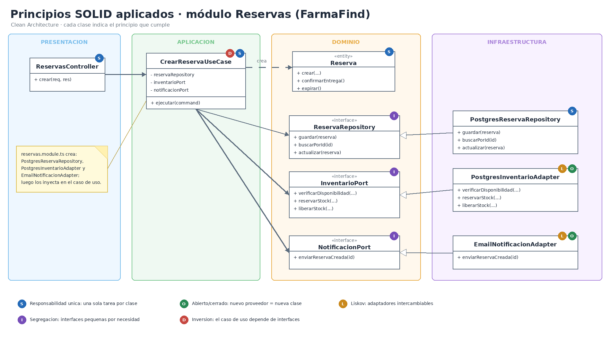

# Principios de diseño (SOLID)

## Objetivo

Documentar cómo se aplican los principios SOLID en el backend de FarmaFind, organizado con Clean Architecture, para que cada módulo se programe de forma uniforme y las reglas de negocio no dependan de la tecnología.

## Contexto

- **Estilo:** monolito modular con servicio separado de notificaciones.
- **Backend:** Node.js + Express.
- **Enfoque interno:** Clean Architecture: presentación, aplicación, dominio e infraestructura.
- **Módulo de referencia:** Reservas, porque integra reglas de negocio, inventario, base de datos y notificaciones.

## SOLID en el módulo Reservas

| Principio | Dónde se aplica (capa) | Cómo se cumple en FarmaFind | Archivos |
|---|---|---|---|
| **S** · Responsabilidad única | Todas las capas | Cada clase tiene una sola tarea: el controlador recibe la petición HTTP, el caso de uso coordina la reserva, la entidad aplica las reglas de la reserva y el repositorio guarda en PostgreSQL. | `reservas.controller.ts`, `crear-reserva.use-case.ts`, `reserva.ts`, `postgres-reserva.repository.ts` |
| **O** · Abierto/cerrado | Infraestructura | Para agregar otro proveedor de notificaciones, pagos o mapas se crea un nuevo adaptador; los casos de uso no se modifican. | `email-notificacion.adapter.ts`, `sms-notificacion.adapter.ts`, `pasarela-pago.adapter.ts`, `maps.adapter.ts` |
| **L** · Sustitución de Liskov | Infraestructura | Los adaptadores que implementan un mismo puerto deben comportarse igual. Por ejemplo, correo y SMS pueden reemplazarse porque ambos cumplen `NotificacionPort`. | `email-notificacion.adapter.ts`, `sms-notificacion.adapter.ts`, `notificacion-port.ts` |
| **I** · Segregación de interfaces | Dominio | Cada interfaz tiene solo lo que el módulo necesita: `ReservaRepository` guarda y consulta reservas, `InventarioPort` verifica y actualiza stock, y `NotificacionPort` envía avisos. | `reserva-repository.ts`, `inventario-port.ts`, `notificacion-port.ts` |
| **D** · Inversión de dependencias | Aplicación | El caso de uso recibe interfaces por el constructor y no conoce Express, PostgreSQL ni proveedores externos; las implementaciones concretas se conectan en el módulo. | `crear-reserva.use-case.ts`, `reservas.module.ts` |

## Qué pasaría sin SOLID en FarmaFind

| Situación real | Sin SOLID | Con SOLID |
|---|---|---|
| Se cambia el proveedor de notificaciones | Habría que modificar el caso de uso de reservas. | Solo se crea o reemplaza el adaptador de notificaciones. |
| Se cambia PostgreSQL por otra forma de persistencia | La lógica de negocio estaría mezclada con consultas SQL. | Solo se cambia la implementación del repositorio. |
| Se desea probar la creación de una reserva | Se necesitaría una base de datos real y un servicio de notificaciones activo. | Se puede probar con repositorios y adaptadores simulados. |
| Cambia una regla de reserva | Habría que buscar la regla en controladores, rutas o consultas SQL. | La regla se modifica en la entidad `Reserva` o en el caso de uso correspondiente. |
| Se agrega pago opcional a la reserva | Se mezclaría la lógica de pago con la lógica principal de reserva. | Se agrega un `PagoPort` y un adaptador de pasarela externa. |

## Relación con Clean Architecture y los patrones

| Principio | Lo cumple en el proyecto |
|---|---|
| Responsabilidad única | La separación por capas: presentación, aplicación, dominio e infraestructura. |
| Abierto/cerrado | El uso de adaptadores para notificaciones, pagos, mapas e inventario externo futuro. |
| Sustitución de Liskov | Los adaptadores que implementan el mismo puerto pueden reemplazarse sin alterar el caso de uso. |
| Segregación de interfaces | Los puertos del dominio se dividen según necesidad: `ReservaRepository`, `InventarioPort`, `NotificacionPort` y `PagoPort`. |
| Inversión de dependencias | Los casos de uso dependen de interfaces del dominio, no de Express, PostgreSQL ni servicios externos. |

## Beneficio

- El backend queda más ordenado y fácil de mantener.
- Las reglas de negocio de FarmaFind quedan protegidas de cambios tecnológicos.
- Los módulos pueden probarse sin depender siempre de servicios reales.
- Se facilita agregar nuevas funciones como pagos, mapas, notificaciones o inventario externo.
- El equipo puede seguir una misma forma de programación en reservas, inventario, medicamentos, farmacias y usuarios.