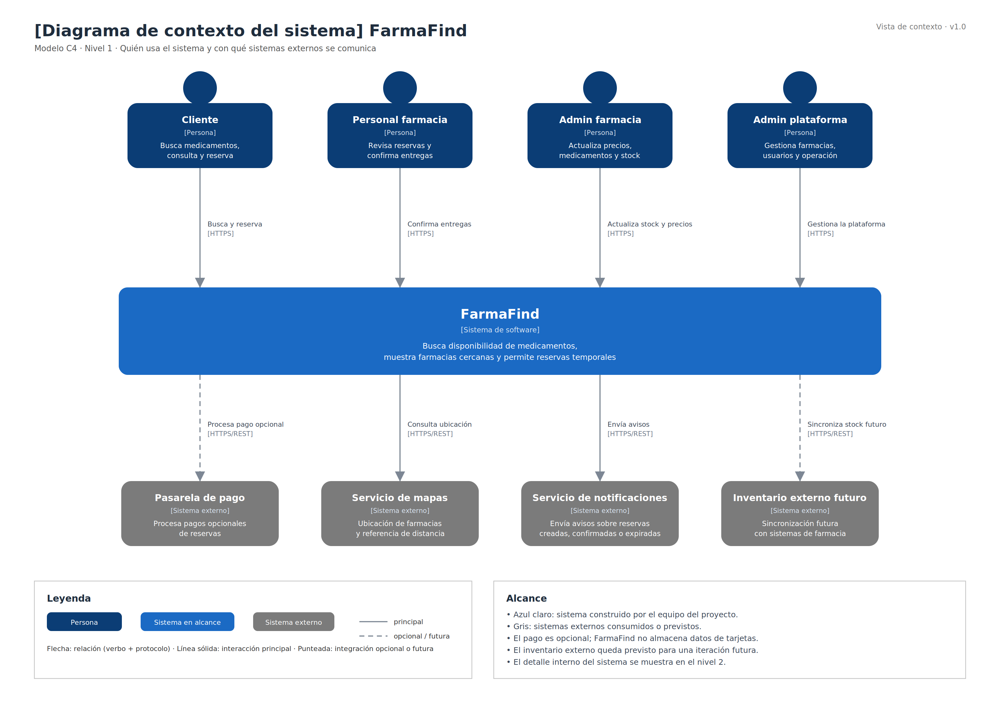

# Nivel 1 · Diagrama de contexto del sistema

> **Proyecto:** FarmaFind  
> **Modelo:** C4 · Nivel 1 de 4 · **Versión:** 1.0

---

## 1. Objetivo

Mostrar a **FarmaFind como una sola caja**: quiénes lo usan y con qué sistemas externos se comunica. Es la vista de mayor nivel y permite entender el alcance general del sistema sin entrar todavía en tecnologías, módulos internos o base de datos.

| Aspecto | Descripción |
|---|---|
| Pregunta que responde | ¿Qué es el sistema, quién lo usa y con quién se integra? |
| Audiencia | Todos: docente, equipo de desarrollo, usuarios, administración y operación |
| Qué **no** muestra | Tecnologías internas, servidores, base de datos, módulos ni componentes del backend |
| Siguiente nivel | `Nivel2-DiagramadeContenedores.md` |

---

## 2. Diagrama

> Archivo editable: `img/fuentes/nivel1-contexto-farmafind.png`

---

## 3. Personas (usuarios)

| Persona | Descripción | Qué hace en el sistema |
|---|---|---|
| **Cliente** | Persona que necesita encontrar un medicamento disponible en una farmacia. | Busca medicamentos por nombre comercial o principio activo, revisa disponibilidad, precio referencial y ubicación, y realiza una reserva temporal. |
| **Personal de farmacia** | Trabajador encargado de atender reservas realizadas por los clientes. | Revisa las reservas pendientes, valida los datos y confirma la entrega del medicamento cuando el cliente lo recoge. |
| **Administrador de farmacia** | Responsable de mantener actualizada la información de una farmacia afiliada. | Registra medicamentos, actualiza precios, controla stock y mantiene visible la información de su farmacia. |
| **Administrador de plataforma** | Responsable de la operación general de FarmaFind. | Gestiona farmacias afiliadas, administra usuarios, supervisa el funcionamiento del sistema y configura funciones complementarias. |

---

## 4. Sistemas

| Sistema | Tipo | Responsabilidad | Quién lo construye |
|---|---|---|---|
| **FarmaFind** | Sistema en alcance | Permite buscar medicamentos disponibles, consultar farmacias, revisar precio y ubicación, realizar reservas temporales y administrar información de farmacias. | El equipo del proyecto |
| **Pasarela de pago** | Sistema externo opcional | Procesa el pago de una reserva si se habilita el pago dentro de la plataforma. | Proveedor de pagos |
| **Servicio de mapas** | Sistema externo | Permite mostrar ubicación de farmacias y calcular cercanía o referencia de distancia. | Proveedor de mapas |
| **Servicio de notificaciones** | Sistema externo o servicio separado | Envía avisos relacionados con creación, confirmación o expiración de reservas. | Equipo del proyecto o proveedor externo |
| **Inventario externo futuro** | Sistema externo previsto | Permitiría sincronizar stock con sistemas propios de las farmacias en una futura iteración. | Sistema de cada farmacia o proveedor externo |

---

## 5. Relaciones

| Origen | Destino | Descripción | Protocolo |
|---|---|---|---|
| Cliente | FarmaFind | Busca medicamentos, consulta disponibilidad y realiza reservas temporales. | — |
| Personal de farmacia | FarmaFind | Consulta reservas pendientes y confirma entregas. | — |
| Administrador de farmacia | FarmaFind | Registra y actualiza medicamentos, precios y stock. | — |
| Administrador de plataforma | FarmaFind | Gestiona usuarios, farmacias afiliadas y configuración general. | — |
| FarmaFind | Pasarela de pago | Solicita el procesamiento de un pago opcional. | HTTPS/REST |
| FarmaFind | Servicio de mapas | Consulta ubicación, distancia o referencia geográfica de farmacias. | HTTPS/REST |
| FarmaFind | Servicio de notificaciones | Envía avisos sobre creación, confirmación o expiración de reservas. | HTTPS/REST |
| FarmaFind | Inventario externo futuro | Consulta o sincroniza información de stock cuando exista integración con farmacias. | HTTPS/REST |

> En el nivel 1 no se detalla el protocolo entre personas y sistema. Esa información se especifica en el nivel 2 mediante los contenedores y canales de comunicación.

---

## 6. Decisiones y supuestos

| # | Decisión o supuesto | Motivo |
|---|---|---|
| 1 | FarmaFind se presenta como un único sistema en el nivel de contexto. | El nivel 1 busca explicar el alcance general, no la estructura interna. |
| 2 | Las integraciones externas se realizarán mediante API REST. | Permite desacoplar FarmaFind de los proveedores externos y aplicar el patrón Adapter. |
| 3 | El pago dentro de FarmaFind será opcional. | El sistema puede funcionar con reserva y recojo en farmacia, sin obligar al pago en línea. |
| 4 | FarmaFind no almacena datos sensibles de tarjetas. | Los datos de pago son responsabilidad de la pasarela externa, reduciendo riesgos de seguridad. |
| 5 | La actualización de inventario será manual en el MVP. | Permite iniciar el sistema sin depender de integraciones complejas con cada farmacia. |
| 6 | La integración con inventario externo queda prevista para una iteración futura. | Algunas farmacias podrían tener sistemas propios, pero no es obligatorio en la primera versión. |

### Pendientes por definir

| Tema | Detalle |
|---|---|
| Proveedor de mapas | Definir si se usará Google Maps, OpenStreetMap u otro servicio similar. |
| Canal de notificaciones | Confirmar si las notificaciones serán por correo, SMS, WhatsApp u otro canal. |
| Pago opcional | Definir si el pago se habilitará desde el MVP o quedará para una siguiente iteración. |
| Integración de inventario externo | Confirmar qué farmacias tendrían sistema propio y qué datos podrían sincronizar. |

---