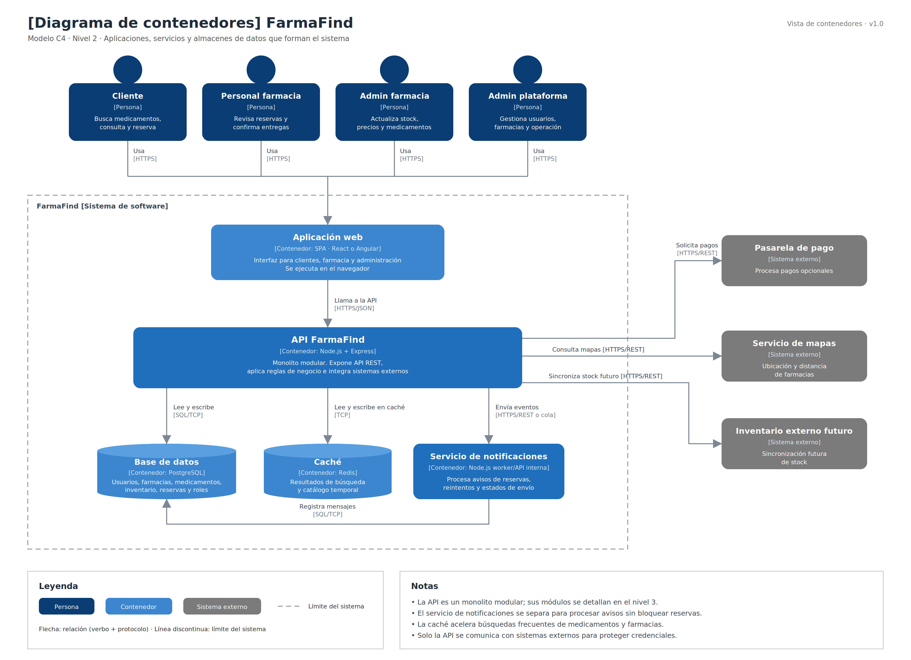

# Nivel 2 · Diagrama de contenedores

> **Proyecto:** FarmaFind  
> **Modelo:** C4 · Nivel 2 de 4 · **Versión:** 1.0

---

## 1. Objetivo

Abrir la caja «FarmaFind» del nivel 1 y mostrar los **contenedores** que forman el sistema: las aplicaciones, servicios y almacenes de datos que se ejecutan por separado, la tecnología de cada uno y cómo se comunican.

| Aspecto | Descripción |
|---|---|
| Pregunta que responde | ¿De qué piezas ejecutables se compone el sistema y con qué tecnología? |
| Audiencia | Arquitectos, desarrolladores, operaciones y equipo del proyecto |
| Qué es un contenedor | Algo que se ejecuta o almacena datos de forma independiente: aplicación web, API, servicio, base de datos o caché |
| Nivel anterior | `Nivel1-DiagramadeContextodelSistema.md` |
| Siguiente nivel | `Nivel3-Diagrama-de-Componentes.md` |

---

## 2. Diagrama

> Archivo editable: `img/fuentes/nivel2-contenedores-farmafind.drawio`

---

## 3. Contenedores

| Contenedor | Tecnología | Responsabilidad | Datos que maneja |
|---|---|---|---|
| **Aplicación web** | SPA · React o Angular | Interfaz para clientes, personal de farmacia, administradores de farmacia y administrador de plataforma. Se ejecuta en el navegador. | Estado temporal de pantalla, formularios, filtros y sesión del usuario. |
| **API FarmaFind** | Node.js + Express | Expone la API REST, aplica reglas de negocio e integra servicios externos. Es un **monolito modular** con módulos internos. | No almacena datos directamente; usa base de datos, caché y servicios externos. |
| **Servicio de notificaciones** | Node.js + worker/API interna | Procesa avisos relacionados con reservas creadas, confirmadas o próximas a expirar. | Mensajes pendientes, eventos de reserva y estado de envío. |
| **Base de datos** | PostgreSQL | Almacena de forma permanente la información principal del sistema. | Usuarios, farmacias, medicamentos, inventario, reservas, roles y auditoría básica. |
| **Caché** | Redis | Guarda consultas frecuentes para acelerar búsquedas de medicamentos y farmacias. | Resultados temporales de búsqueda, filtros frecuentes y datos de catálogo consultado. |

---

## 4. Relaciones

| Origen | Destino | Descripción | Protocolo |
|---|---|---|---|
| Cliente, personal de farmacia, administrador de farmacia y administrador de plataforma | Aplicación web | Usan la aplicación desde el navegador. | HTTPS |
| Aplicación web | API FarmaFind | Envía solicitudes para buscar medicamentos, gestionar reservas, administrar stock y usuarios. | HTTPS/JSON |
| API FarmaFind | Base de datos | Lee y escribe información principal del sistema. | SQL sobre TCP |
| API FarmaFind | Caché | Consulta y guarda resultados temporales de búsquedas frecuentes. | TCP |
| API FarmaFind | Servicio de notificaciones | Envía eventos para generar avisos relacionados con reservas. | HTTPS/REST o cola interna |
| Servicio de notificaciones | Base de datos | Registra mensajes pendientes, enviados o fallidos. | SQL sobre TCP |
| API FarmaFind | Pasarela de pago | Solicita el procesamiento de pagos opcionales. | HTTPS/REST |
| API FarmaFind | Servicio de mapas | Consulta ubicación o distancia referencial de farmacias. | HTTPS/REST |
| API FarmaFind | Inventario externo futuro | Consulta o sincroniza stock con sistemas externos de farmacias. | HTTPS/REST |

---

## 5. Decisiones arquitectónicas reflejadas

| Decisión | Alternativa descartada | Motivo |
|---|---|---|
| Un único contenedor principal de backend como monolito modular | Microservicios para todos los módulos | El alcance académico y el tamaño del equipo favorecen una solución más simple, pero modular para crecer después. |
| Servicio de notificaciones separado | Incluir notificaciones dentro del mismo backend | Permite cumplir la separación de responsabilidades y manejar reintentos sin afectar directamente las reservas. |
| Frontend separado del backend | Páginas generadas completamente en el servidor | La aplicación web puede evolucionar de forma independiente y consumir la API REST. |
| PostgreSQL como base de datos principal | Base de datos NoSQL | Reservas, stock y usuarios requieren consistencia, relaciones y transacciones. |
| Redis como caché de búsquedas frecuentes | Consultar siempre PostgreSQL | Las búsquedas de medicamentos pueden ser frecuentes; la caché mejora el tiempo de respuesta. |
| Solo la API se comunica con servicios externos | Llamar pagos, mapas o inventario externo desde el navegador | Las credenciales quedan protegidas en el servidor y se centraliza la integración. |

---

## 6. Seguridad entre contenedores

| Comunicación | Medida |
|---|---|
| Navegador → Aplicación web y API | Tráfico cifrado con HTTPS. |
| Aplicación web → API FarmaFind | Autenticación con token JWT en operaciones protegidas. |
| API FarmaFind → Base de datos y caché | Acceso restringido desde red interna y credenciales mediante variables de entorno. |
| API FarmaFind → Servicio de notificaciones | Comunicación interna autenticada o restringida por red. |
| API FarmaFind → Sistemas externos | Credenciales de proveedores guardadas solo en el servidor. |
| Operaciones administrativas | Validación de roles y permisos antes de modificar stock, precios, usuarios o farmacias. |

---