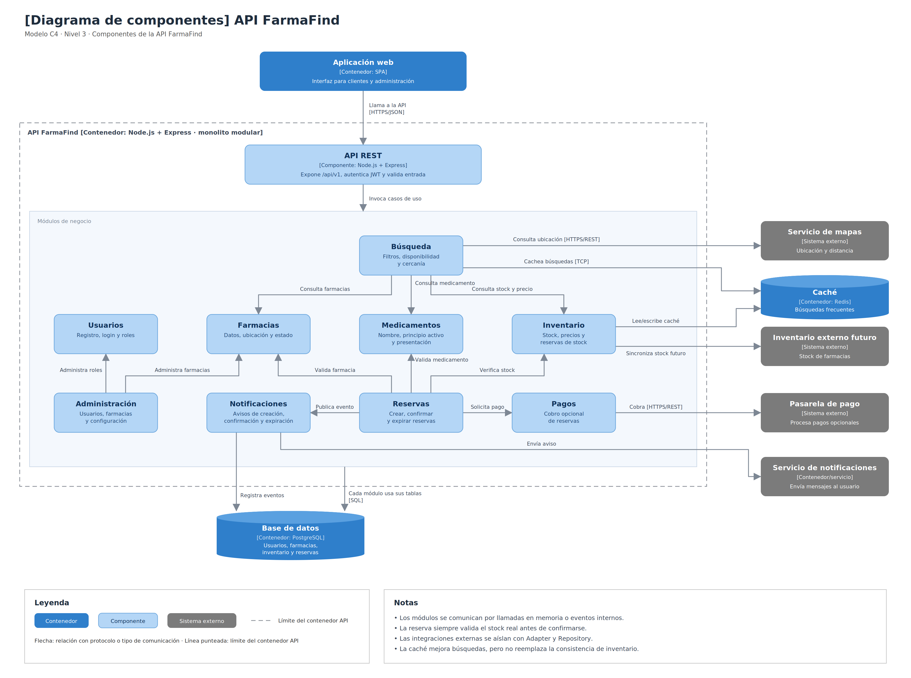

# Nivel 3 · Diagrama de componentes

> **Proyecto:** FarmaFind · **Contenedor detallado:** API FarmaFind  
> **Modelo:** C4 · Nivel 3 de 4 · **Versión:** 1.2  
> **Estado:** Diseño arquitectónico propuesto, pendiente de implementación

---

## 1. Objetivo

Abrir el contenedor **API FarmaFind** del nivel 2 y mostrar sus **componentes**: los módulos internos del monolito modular, las responsabilidades de cada uno y cómo se relacionarán entre sí, con PostgreSQL, Redis y los sistemas externos.

Este nivel permite comprender la organización interna del backend, identificar las dependencias entre módulos y establecer los mecanismos necesarios para garantizar la consistencia de las reservas, el rendimiento de las búsquedas, la seguridad de las operaciones y la comunicación fiable con el servicio independiente de Notificaciones.

La API FarmaFind utilizará Node.js, Express y TypeScript, siguiendo una organización de monolito modular con Clean Architecture dentro de cada módulo.

| Aspecto | Descripción |
|---|---|
| Pregunta que responde | ¿Cómo se divide el backend internamente y qué responsabilidad tiene cada componente? |
| Audiencia | Arquitectos, desarrolladores y equipo del proyecto |
| Qué es un componente | Una agrupación lógica de funcionalidades con responsabilidades y contratos definidos. En FarmaFind, los módulos de negocio representan los componentes principales |
| Contenedor detallado | API FarmaFind, definida en el C4 Nivel 2 |
| Nivel anterior | `Nivel2-DiagramadeContenedores.md` |
| Siguiente nivel | `Nivel4-DiagramadeCodigo.md` |
| Alcance | Componentes propuestos para el MVP y extensiones futuras |

---

## 2. Diagrama

### Descripción general

La API FarmaFind se organizará como un monolito modular.

Cada módulo tendrá una responsabilidad principal y expondrá contratos para permitir la comunicación con otros módulos.

Las operaciones relacionadas con usuarios, farmacias, medicamentos, inventario, búsqueda y reservas se ejecutarán dentro del mismo contenedor backend.

PostgreSQL será la base de datos principal del sistema.

Redis será el contenedor de caché obligatorio del MVP, utilizado para mejorar el rendimiento de las búsquedas de medicamentos y farmacias.

La comunicación con Redis se realizará a través de un adaptador del módulo Búsqueda, sin introducir dependencias tecnológicas dentro del dominio.

Las operaciones críticas de Reservas e Inventario se ejecutarán mediante transacciones PostgreSQL compartidas.

El servicio de Notificaciones se ejecutará independientemente del backend principal y recibirá eventos persistidos mediante Transactional Outbox.

### Alcance del diagrama

El diagrama representará los componentes internos del contenedor API FarmaFind.

La aplicación web, PostgreSQL, Redis y el servicio independiente de Notificaciones podrán mostrarse como contenedores externos a la API para explicar sus relaciones.

Redis no será representado como un módulo de negocio interno, sino como una dependencia de infraestructura del módulo Búsqueda.

---

## 3. Componentes

| Componente | Responsabilidad | Funcionalidades principales | Carpeta propuesta en el código |
|---|---|---|---|
| **API REST** | Punto de entrada HTTP del backend | Rutas `/api/v1`, autenticación, validación de solicitudes y manejo de errores | `src/api/` |
| **Usuarios** | Gestión de identidad y acceso | Registro, inicio de sesión, roles y permisos de clientes y administradores | `src/modules/usuarios/` |
| **Farmacias** | Gestión de farmacias afiliadas | Registro, actualización, ubicación, estado y datos de contacto | `src/modules/farmacias/` |
| **Medicamentos** | Gestión del catálogo general | Registro de medicamentos, nombre comercial, principio activo, concentración, presentación y asociación de productos de farmacia al catálogo para evitar duplicidades | `src/modules/medicamentos/` |
| **Inventario** | Control de existencias y precios | Registro manual e importación obligatoria .xlsx/.csv con vista previa, validación y mapeo; stock y precios propios por farmacia, conciliación e historial movimientos_inventario | `src/modules/inventario/` |
| **Búsqueda** | Consulta optimizada de medicamentos | Búsqueda por nombre comercial o principio activo, filtros y almacenamiento temporal de resultados mediante Redis | `src/modules/busqueda/` |
| **Reservas** | Gestión del ciclo de vida de reservas | Crear, consultar, confirmar, cancelar, expirar y registrar entregas | `src/modules/reservas/` |
| **Integración con Notificaciones** | Registro y publicación de eventos | Registro Outbox, publicación de eventos pendientes e integración con el servicio separado | `src/modules/notificaciones/` |
| **Administración** | Operación general de la plataforma | Gestión de usuarios, farmacias afiliadas y configuración | `src/modules/administracion/` |
| **Pagos** | Integración opcional con pasarelas de pago | Procesamiento de pagos y consulta de resultados en una futura iteración | `src/modules/pagos/` |

### 3.1 Componentes principales del MVP

Los componentes principales previstos serán:

- API REST.
- Usuarios.
- Farmacias.
- Medicamentos.
- Inventario.
- Búsqueda.
- Reservas.
- Integración con Notificaciones.
- Administración.

Además, el módulo Búsqueda incorporará un adaptador de infraestructura para Redis.

El componente Pagos permanecerá previsto para una futura iteración.

Las búsquedas públicas no requerirán autenticación.

Las operaciones protegidas requerirán identidad y permisos correspondientes.

### 3.2 Componente Búsqueda

El módulo Búsqueda mostrará disponibilidad y precios referenciales y fecha de última revisión por la farmacia; la existencia física se comprobará antes de aceptar la reserva.

Se diseñará siguiendo Clean Architecture y utilizará contratos para consultar Medicamentos, Farmacias e Inventario.

También contará con una abstracción para almacenar temporalmente los resultados de las consultas.

#### Componentes internos propuestos

| Elemento | Capa | Responsabilidad |
|---|---|---|
| `BusquedaController` | Presentación | Recibe solicitudes HTTP de búsqueda. |
| `BuscarMedicamentosUseCase` | Aplicación | Coordina la consulta, los filtros y la utilización de caché. |
| `BusquedaRepository` | Contrato interno | Define las consultas de búsqueda sobre los datos principales. |
| `BusquedaCachePort` | Contrato de aplicación | Define operaciones para consultar, almacenar e invalidar resultados temporales. |
| `PostgresBusquedaRepository` | Infraestructura | Implementa consultas de búsqueda sobre PostgreSQL. |
| `RedisBusquedaCacheAdapter` | Infraestructura | Implementa el contrato de caché utilizando Redis. |

#### Estrategia Cache-Aside

El módulo aplicará Cache-Aside:

1. Recibirá una solicitud de búsqueda.
2. Construirá una clave considerando los parámetros de la consulta.
3. Consultará Redis mediante `BusquedaCachePort`.
4. Si existe información válida, devolverá el resultado.
5. Si no existe, consultará PostgreSQL.
6. Almacenará temporalmente el resultado en Redis.
7. Devolverá la información al cliente.

El módulo Búsqueda dependerá de contratos y no del cliente Redis directamente.

#### Expiración de resultados

Las entradas de caché utilizarán TTL configurable.

Se propone un TTL inicial de 60 segundos para consultas que incluyan disponibilidad o precios, sujeto a pruebas de rendimiento y actualización de datos.

Las modificaciones relevantes deberán invalidar las entradas afectadas mediante una estrategia de versionado, invalidación por grupos u otro mecanismo definido durante la implementación.

El TTL limitará la duración de los resultados que no hayan sido invalidados explícitamente.

#### Manejo de fallos

Si Redis no está disponible, el módulo Búsqueda deberá consultar PostgreSQL directamente.

La indisponibilidad de Redis podrá afectar el rendimiento, pero no deberá impedir el uso de las funciones principales.

La creación de reservas nunca dependerá de la disponibilidad de Redis.

### 3.3 Componente Reservas

El módulo Reservas gestionará el ciclo de vida de las reservas temporales.

Los estados definidos serán:

| Estado | Descripción |
|---|---|
| PENDIENTE | Reserva registrada con stock comprometido, pendiente de aceptación por la farmacia |
| CONFIRMADA | Reserva aceptada por la farmacia y pendiente de recojo |
| ENTREGADA | Reserva cuya entrega fue confirmada |
| CANCELADA | Reserva cancelada antes de la entrega y con el stock liberado |
| EXPIRADA | Reserva cuyo plazo terminó sin entrega y con el stock liberado |

Los estados ENTREGADA, CANCELADA y EXPIRADA serán terminales.

Las transiciones válidas estarán definidas en el dominio. PENDIENTE tendrá un plazo de respuesta configurable de 20 minutos iniciales; solo el dueño, administrador o personal expresamente delegado podrá aceptarla vigente tras comprobar físicamente el producto. Al aceptar se asignará un plazo de recogida configurable de 24 horas inicialmente propuestas, sujeto a validación. Ante falta física, se cancelará PENDIENTE con motivo STOCK_FISICO_INSUFICIENTE, liberación única, incidencia, movimiento y alerta Outbox en una misma transacción.

El módulo Reservas coordinará con Inventario las operaciones de compromiso, liberación y salida definitiva de stock.

Estas operaciones utilizarán PostgreSQL y no Redis.

### 3.4 Componente Inventario

El módulo Inventario administrará las existencias y precios asociados a los medicamentos ofrecidos por cada farmacia.

Se distinguirán:

| Concepto | Descripción |
|---|---|
| Stock físico | Cantidad registrada por la farmacia, sujeta a discrepancias con la existencia observada |
| Stock comprometido | Cantidad asignada temporalmente a reservas vigentes |
| Stock disponible | Stock físico menos stock comprometido |

La importación usará una plantilla propuesta de nombre, concentración, presentación, precio referencial y stock físico, sin asumir columnas uniformes. Inventario consultará el catálogo general de Medicamentos mediante contrato público para evitar duplicidades. Los ajustes e importaciones no sobrescribirán compromisos ni dejarán stock físico inferior al comprometido; exigirán conciliación y revalidación concurrente al guardar. Para el MVP, la importación será atómica por archivo: si una fila es inválida o no está conciliada, no se guardará ninguna; se presentará un reporte de errores para corregir y reintentar. El archivo completo se guardará en una única transacción.

PostgreSQL conservará movimientos_inventario con producto, farmacia, cantidad anterior y nueva, motivo, responsable y fecha. La revisión de inventario por la farmacia actualizará la fecha mostrada al cliente; consultas, caché y compromisos no renovarán esa fecha.

Las operaciones de compromiso de stock deberán ser atómicas.

La creación de reservas no podrá comprometer más unidades que las disponibles.

Cuando se cancele o expire una reserva, las unidades comprometidas deberán liberarse una sola vez.

Cuando una reserva sea entregada, las unidades comprometidas deberán registrarse como salida definitiva del inventario.

Los cambios relevantes de inventario deberán producir una invalidación de caché para reducir la exposición de resultados desactualizados.

La invalidación se realizará después de confirmar la transacción de inventario, utilizando un mecanismo fiable de procesamiento de eventos o actualización.

La actualización de Redis no formará parte de la transacción PostgreSQL.

### 3.5 Componente de integración con Notificaciones

El núcleo FarmaFind incluirá un componente de integración con Notificaciones.

Este componente registrará y publicará eventos del ciclo de reservas, alertas de corrección y recordatorios propuestos por inventario antiguo. Los recordatorios tendrán umbral y frecuencia configurables y no alterarán existencias.

No será responsable de enviar directamente los avisos finales al cliente.

El registro de eventos se realizará mediante Transactional Outbox dentro de PostgreSQL.

Un publicador procesará los eventos pendientes posteriormente y los enviará al servicio independiente de Notificaciones mediante HTTPS/REST autenticado.

El servicio consumidor aplicará deduplicación y reintentos.

La indisponibilidad de Notificaciones no deberá impedir la creación de reservas.

### 3.6 Componente Pagos

El módulo Pagos se mantendrá como extensión futura.

Durante el MVP, las reservas no requerirán pago electrónico.

Cuando se incorpore, se utilizarán contratos y adaptadores para comunicarse con una pasarela externa.

Los estados de pago se definirán independientemente del ciclo de vida de las reservas.

---

## 4. Relaciones entre componentes

| Origen | Destino | Descripción | Tipo de comunicación |
|---|---|---|---|
| Aplicación web | API REST | Envía solicitudes para ejecutar operaciones del sistema. | HTTPS/JSON |
| API REST | Módulos de negocio | Invoca casos de uso según las rutas solicitadas. | Llamada en memoria |
| API REST | Usuarios | Verifica identidad y permisos para operaciones protegidas. | Llamada en memoria |
| Búsqueda | Medicamentos | Consulta información general de medicamentos. | Contrato público del módulo |
| Búsqueda | Farmacias | Consulta información y ubicación de farmacias. | Contrato público del módulo |
| Búsqueda | Inventario | Consulta disponibilidad y precios referenciales. | Contrato público del módulo |
| Búsqueda | `BusquedaCachePort` | Consulta, almacena e invalida resultados temporales. | Contrato interno |
| `RedisBusquedaCacheAdapter` | Redis | Accede a los datos almacenados temporalmente en caché. | Protocolo Redis |
| `PostgresBusquedaRepository` | PostgreSQL | Ejecuta consultas cuando no existe un resultado válido en caché. | SQL |
| Reservas | Inventario | Compromete, libera y confirma salidas de stock. | Contrato público del módulo |
| Reservas | Medicamentos | Valida existencia del medicamento. | Contrato público del módulo |
| Reservas | Farmacias | Valida existencia y disponibilidad de la farmacia. | Contrato público del módulo |
| Reservas | Usuarios | Verifica identidad y permisos relacionados con reservas. | Contrato público del módulo |
| Reservas | Integración con Notificaciones | Solicita registrar eventos relacionados con reservas. | Contrato interno |
| Integración con Notificaciones | Publicador Outbox | Procesa eventos persistidos pendientes. | Procesamiento interno |
| Administración | Usuarios | Gestiona usuarios y permisos. | Contrato público del módulo |
| Administración | Farmacias | Gestionará afiliaciones y supervisión sin asumir el inventario de cada farmacia. | Contrato público del módulo |
| Inventario | Medicamentos | Asociará productos registrados o importados al catálogo general. | Contrato público del módulo |
| Inventario | Integración con Notificaciones | Registrará alertas de corrección y recordatorios propuestos de actualización. | Contrato interno |

### 4.1 Relación entre Búsqueda y Redis

Redis será utilizado por el módulo Búsqueda a través de un adaptador.

El caso de uso no dependerá directamente de la librería Redis.

El adaptador permitirá implementar operaciones como:

- Obtener un resultado almacenado.
- Almacenar un resultado con TTL.
- Invalidar entradas relacionadas con información modificada.
- Manejar errores de conexión sin impedir la consulta principal.

Las claves deberán contemplar filtros, ordenamiento, paginación y parámetros que afecten al resultado.

La caché contendrá exclusivamente información apropiada para consultas autorizadas.

### 4.2 Relación transaccional entre Reservas e Inventario

Reservas e Inventario se ejecutarán dentro del mismo backend.

Su comunicación utilizará contratos públicos y una unidad de trabajo transaccional compartida.

La creación de una reserva seguirá las operaciones:

1. Validar identidad y datos.
2. Iniciar una transacción PostgreSQL.
3. Comprometer stock de manera atómica.
4. Crear la reserva con estado PENDIENTE.
5. Guardar la reserva.
6. Registrar el evento Outbox.
7. Confirmar la transacción.

Si falla una operación, se revertirá la transacción.

Redis no participará en la confirmación de reservas.

### 4.3 Relación entre Inventario y la invalidación de caché

El módulo Inventario será responsable de generar información sobre cambios relevantes de stock y precios.

Una vez confirmados los cambios en PostgreSQL, un mecanismo de integración deberá invalidar las entradas relacionadas en Redis.

El mecanismo deberá evitar invalidaciones antes del commit que puedan provocar recargas con datos todavía no confirmados.

Como el mismo medicamento puede aparecer en múltiples búsquedas, se definirán reglas de invalidación que contemplen resultados compartidos y diferentes filtros.

Si el mecanismo de invalidación falla temporalmente, las entradas expirarán mediante el TTL configurado y se aplicarán reintentos cuando corresponda.

La invalidación será una operación de mantenimiento de caché, no una modificación de la información oficial de inventario.

### 4.4 Relación entre Reservas y Notificaciones

El módulo Reservas solicitará registrar eventos a través de un contrato interno.

Estos eventos se almacenarán dentro de PostgreSQL mediante Transactional Outbox.

Un publicador independiente de las solicitudes HTTP enviará los eventos pendientes al servicio separado de Notificaciones.

La comunicación utilizará HTTPS/REST autenticado.

El servicio de Notificaciones aplicará deduplicación por identificador de evento.

### 4.5 Relación entre Reservas y Pagos

Durante el MVP, el flujo de creación de reservas no requerirá pago electrónico.

La integración con Pagos se considerará una funcionalidad futura.

Cuando se incorpore, se utilizarán contratos y adaptadores independientes de la lógica principal de inventario y reservas.

---

## 5. Relaciones con contenedores y sistemas externos

| Componente | Destino | Descripción | Protocolo | Patrón aplicado |
|---|---|---|---|---|
| Usuarios | PostgreSQL | Guarda usuarios, credenciales protegidas y roles. | SQL | Repository |
| Farmacias | PostgreSQL | Guarda datos de farmacias, ubicación y estado. | SQL | Repository |
| Medicamentos | PostgreSQL | Guarda información general de medicamentos. | SQL | Repository |
| Inventario | PostgreSQL | Guarda existencias, unidades comprometidas y precios. | SQL | Repository |
| Reservas | PostgreSQL | Guarda reservas, estados, cantidades y fechas de expiración. | SQL | Repository |
| Reservas e Inventario | PostgreSQL | Ejecutan operaciones críticas dentro de una transacción compartida. | SQL transaccional | Unit of Work |
| Búsqueda | PostgreSQL | Obtiene datos principales para consultas de búsqueda. | SQL | Repository |
| Búsqueda | Redis | Consulta y almacena resultados temporales con TTL e invalidación. | Protocolo Redis | Cache-Aside / Adapter |
| Integración con Notificaciones | PostgreSQL | Registra eventos pendientes. | SQL transaccional | Transactional Outbox |
| Publicador Outbox | Servicio de Notificaciones | Publica eventos pendientes mediante reintentos. | HTTPS/REST | Adapter |
| Servicio de Notificaciones | Proveedor de mensajes | Envía avisos relacionados con reservas. | API del proveedor | Adapter |
| Farmacias/Búsqueda | Servicio de mapas | Consulta ubicación o distancia referencial. | HTTPS/REST | Adapter |
| Pagos | Pasarela de pago futura | Procesará pagos electrónicos opcionales. | HTTPS/REST | Adapter |
| Inventario | Inventario externo futuro | Permitirá sincronizar stock con sistemas externos de farmacias. | HTTPS/REST | Adapter |

### 5.1 Persistencia transaccional

PostgreSQL será la fuente oficial de información del sistema.

Las operaciones críticas sobre Reservas e Inventario utilizarán transacciones compartidas.

Los repositorios permanecerán separados por módulo, pero utilizarán el mismo contexto transaccional cuando una operación requiera actualizar información relacionada.

### 5.2 Caché de búsquedas

Redis se utilizará como una optimización de rendimiento.

No será responsable de almacenar reservas ni de confirmar stock.

Las consultas podrán beneficiarse de resultados temporales mientras su validez esté controlada mediante TTL e invalidación.

La arquitectura permitirá realizar pruebas comparativas con y sin caché para verificar el cumplimiento del atributo de calidad AC01.

### 5.3 Integración con Notificaciones

Los eventos se registrarán en PostgreSQL utilizando Transactional Outbox.

La publicación se realizará posteriormente a la confirmación de las operaciones principales.

El servicio independiente de Notificaciones procesará los eventos y evitará trabajos duplicados.

### 5.4 Integraciones futuras

| Integración | Finalidad | Estado |
|---|---|---|
| Pasarela de pago | Permitir pagos electrónicos. | Futuro |
| Inventario externo | Sincronizar existencias con sistemas de farmacias. | Futuro |
| Proveedor de mapas | Obtener ubicación y distancias mediante un servicio definido. | Pendiente de selección |

Redis no se incluye en esta tabla porque constituye una dependencia obligatoria del MVP.

---

## 6. Reglas del monolito modular

| # | Regla | Motivo |
|---|---|---|
| 1 | Los componentes principales se desplegarán juntos dentro de la API FarmaFind. | Mantiene el monolito modular. |
| 2 | Un módulo utilizará otro mediante contratos públicos o casos de uso expuestos. | Reduce el acoplamiento. |
| 3 | Un módulo no deberá modificar directamente las tablas internas de otro módulo. | Conserva los límites lógicos. |
| 4 | Las integraciones externas deberán encapsularse mediante adaptadores. | Facilita el cambio de proveedores. |
| 5 | Cada módulo seguirá Clean Architecture. | Evita dependencias tecnológicas en el dominio. |
| 6 | Reservas e Inventario utilizarán transacciones PostgreSQL compartidas para operaciones críticas. | Garantiza consistencia. |
| 7 | Redis será una caché obligatoria del MVP destinada al módulo Búsqueda. | Mejora el rendimiento de las consultas frecuentes. |
| 8 | El módulo Búsqueda utilizará Cache-Aside mediante un puerto y un adaptador Redis. | Mantiene desacoplamiento tecnológico. |
| 9 | Las entradas de caché tendrán TTL e invalidación ante modificaciones relevantes. | Reduce resultados desactualizados. |
| 10 | Una falla de Redis no deberá impedir las búsquedas ni las reservas. | Mejora la tolerancia a fallos. |
| 11 | Redis no será utilizado para confirmar disponibilidad ni modificar stock. | Mantiene PostgreSQL como fuente oficial. |
| 12 | Los estados de reserva deberán respetar las transiciones definidas por el dominio. | Evita transiciones inválidas. |
| 13 | Las cancelaciones y expiraciones liberarán el stock una sola vez. | Evita inconsistencias. |
| 14 | La entrega registrará la salida definitiva de unidades comprometidas. | Mantiene el inventario consistente. |
| 15 | La creación de reservas no dependerá de la disponibilidad de Notificaciones. | Mejora la resiliencia. |
| 16 | Los eventos de notificación se registrarán mediante Transactional Outbox. | Evita pérdida de eventos. |
| 17 | Notificaciones aplicará deduplicación y reintentos. | Facilita la recuperación. |
| 18 | Las operaciones protegidas verificarán identidad, rol y permisos sobre los recursos. | Garantiza seguridad. |
| 19 | El pago electrónico no será obligatorio durante el MVP. | Mantiene el alcance definido. |
| 20 | Los cambios de datos relevantes activarán mecanismos de invalidación después del commit. | Evita mantener resultados incorrectos en caché. |

### 6.1 Reglas de consistencia de reservas

Las reservas utilizarán los estados:

- PENDIENTE.
- CONFIRMADA.
- ENTREGADA.
- CANCELADA.
- EXPIRADA.

Los estados ENTREGADA, CANCELADA y EXPIRADA serán terminales.

Las operaciones que afecten inventario y reservas se realizarán de manera transaccional.

La disponibilidad se validará mediante PostgreSQL.

### 6.2 Reglas de caché

Redis se utilizará únicamente para resultados temporales de búsqueda y datos de catálogo apropiados para almacenamiento en caché.

Las claves deberán representar correctamente los parámetros de la consulta.

Los resultados deberán tener un TTL configurable.

Los cambios relevantes deberán invalidar entradas afectadas después de su confirmación en PostgreSQL.

Ante fallos de Redis se utilizará PostgreSQL directamente.

### 6.3 Reglas de comunicación entre módulos

Los módulos no deberán depender de implementaciones internas de otros módulos.

La comunicación se realizará mediante contratos y casos de uso.

Los controladores HTTP no deberán consultar directamente las tablas de otros módulos.

La composición de dependencias se realizará en los mecanismos previstos por el backend.

### 6.4 Reglas de integración externa

Las integraciones utilizarán puertos y adaptadores.

Las credenciales deberán mantenerse protegidas.

Los errores de servicios complementarios no deberán comprometer las operaciones críticas.

### 6.5 Reglas de evolución arquitectónica

El proyecto mantendrá un monolito modular con PostgreSQL, Redis y un servicio independiente de Notificaciones.

La adopción de Redis deberá validarse mediante métricas de rendimiento y uso de recursos.

Las futuras extensiones, como pagos e inventario externo, respetarán los límites de los módulos y las decisiones arquitectónicas existentes.
